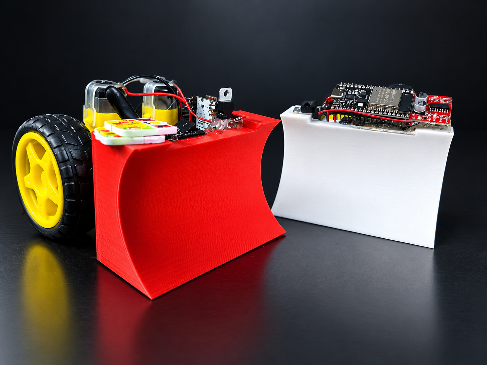
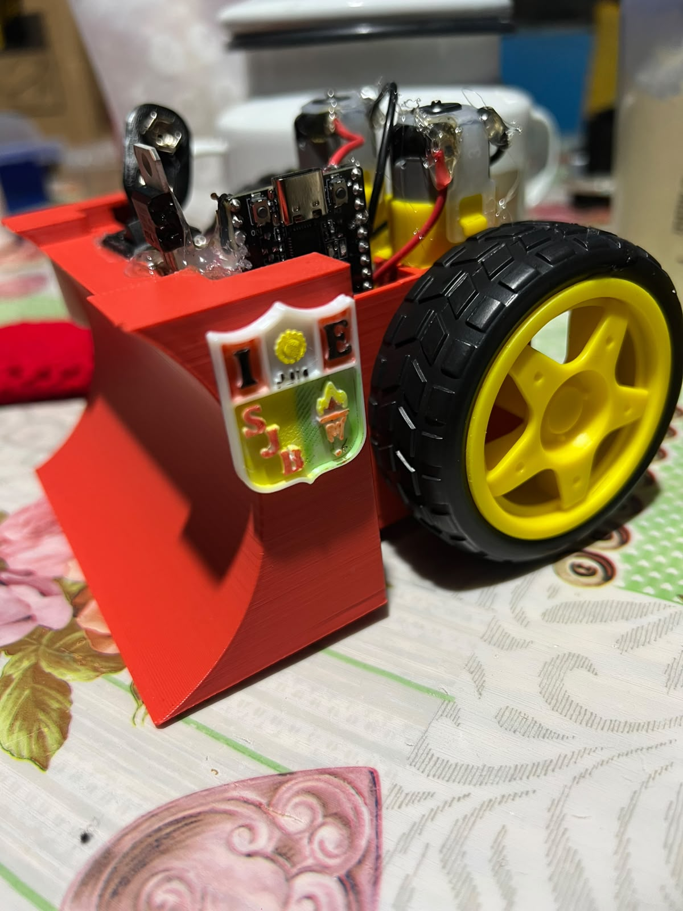
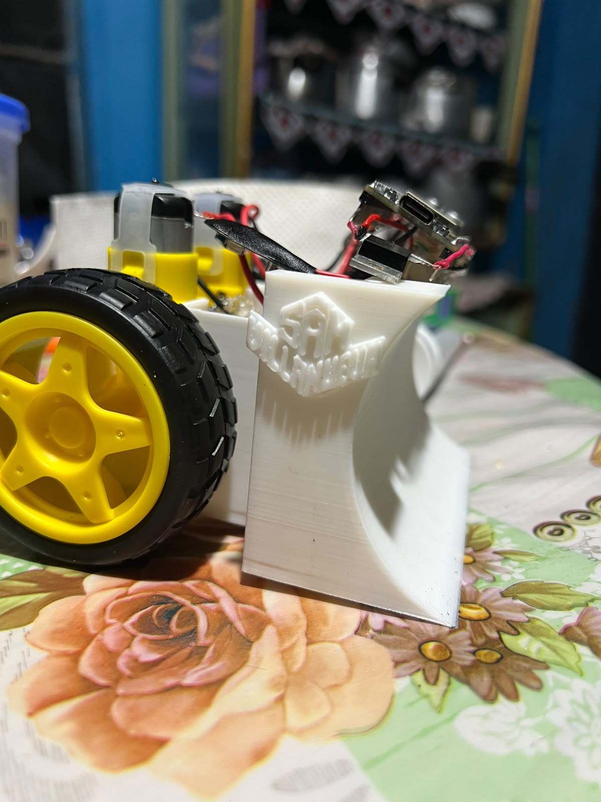
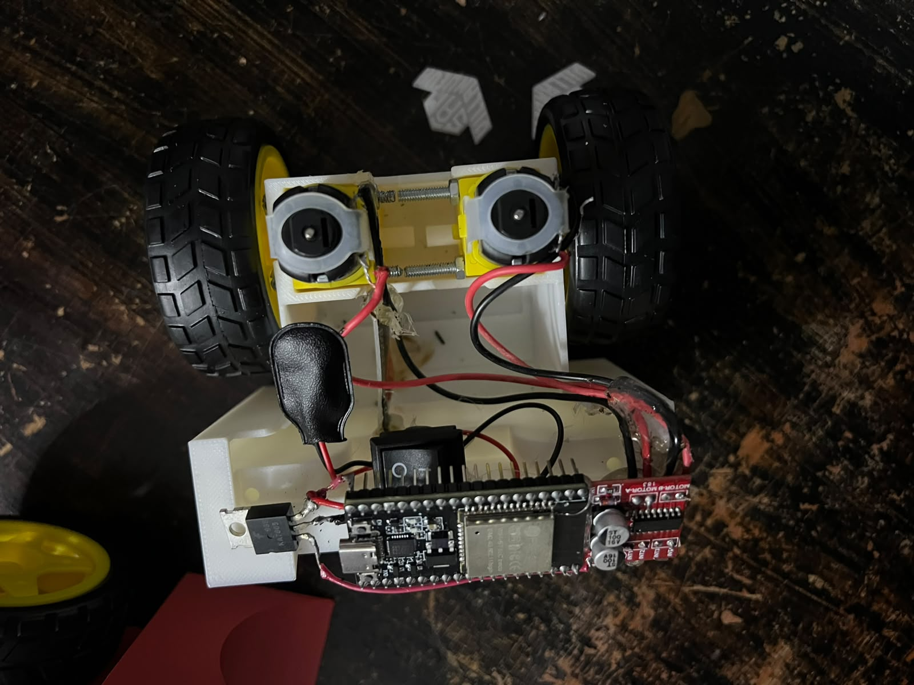
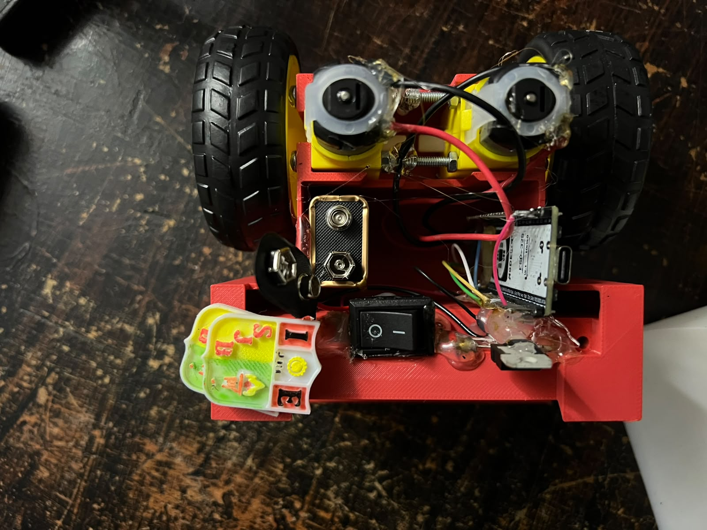

# ⚽ 🚗 Car Soccer - Robot Móvil ESP32 🤖⚡

Repositorio oficial del proyecto **Car Soccer**, un vehículo robótico móvil controlado de forma inalámbrica mediante un servidor web embebido en un **ESP32**, diseñado e implementado para la **I.E. JEC San Juan Bautista - Huariaca**[cite: 1].

---

## 🌟 **Descripción del Proyecto**

Este sistema innovador convierte cualquier teléfono celular en un control de mando inalámbrico a través de una red local Wi-Fi. La interfaz web interactiva está alojada directamente en la memoria flash del **ESP32**, permitiendo pilotar el robot en tiempo real mediante un **Joystick táctil de alta precisión**.

---

## 📸 **Galería y Vistas del Proyecto**

### 🏆 Vistas Principales del Robot
| Vista Principal (Blanco SJB) | Vista de Acabado General | Vista de Acabado Blanco |
| :---: | :---: | :---: |
|  |  |  |

### 🦅 Perspectiva Cenital y Ensamblaje Interno (Vista desde el Cielo)
| Chasis Base Estructural (Blanco) | Chasis y Electrónica Integrada (Rojo) |
| :---: | :---: |
|  |  |

### 🕹️ Interfaces de Control Táctil Web
| Interfaz de Control (SJB) | Interfaz de Control (Sam) |
| :---: | :---: |
|  |  |

### 📐 Modelo 3D del Carro
| Diseño y Proyección 3D |
| :---: |
|  |

---

## 📊 **Diagramas y Documentación Técnica**

El esquema completo de conexiones y la arquitectura electrónica del vehículo se pueden consultar en el siguiente documento oficial:
- 📄 [Descargar / Ver Diagrama del Carro Móvil (PDF)](diagrama_carro_movil.pdf)

---

## ✨ **Características Principales**

- 📶 **Control Inalámbrico Wi-Fi Directo:** Red local propia alojada en el ESP32 para una respuesta inmediata sin retardos.
- 🕹️ **Joystick Virtual Táctil:** Interfaz fluida desarrollada en HTML5/JS que detecta gestos y ejecuta un **freno de seguridad automático** al soltarlo.
- 🎨 **Diseño Cyber-Futurista & Identidad Institucional:** Interfaz gráfica optimizada con colores neón y la insignia oficial de la institución.
- ⚡ **Control de Motores PWM:** Regulación de maniobras gracias al driver L298N Mini / MX1508.

---

## 🧰 **Hardware y Componentes Utilizados**

| Componente | Descripción / Modelo |
| :--- | :--- |
| 🧠 **Microcontrolador** | ESP32 DevKit V1 (Wi-Fi integrado) |
| ⚙️ **Driver de Motores** | L298N Mini / MX1508 (Control Puente H) |
| 🔋 **Alimentación** | Batería recargable con regulador de voltaje L7805CV |
| 🤖 **Actuadores** | Motores DC 6V con caja reductora |
| 📐 **Chasis** | Estructura personalizada optimizada |

---

## 📌 **Esquema de Conexiones (Pinout del ESP32)**

| Pin GPIO ESP32 | Conexión del Hardware | Función Principal |
| :---: | :--- | :--- |
| **GPIO 16** | Driver IN1 | Control de dirección Motor A |
| **GPIO 17** | Driver IN2 | Control de dirección Motor A |
| **GPIO 18** | Driver IN3 | Control de dirección Motor B |
| **GPIO 19** | Driver IN4 | Control de dirección Motor B |
| **GPIO 2** | LED Azul Interno | Indicador visual de estado y conexión Wi-Fi |

---

## 💻 **Organización del Código Fuente**

Los archivos se encuentran distribuidos según su modalidad de red y despliegue:

### 🌐 Códigos con Creación de Red Propia (Access Point)
- `CAR_SOCCER_SJB.ino` - Código principal adaptado con identidad institucional y servidor web integrado.
- `CAR_SOCCER_Kali.ino` - Versión alternativa de pruebas y despliegue del sistema.

### 📡 Códigos de Respuesta Local (Cuando el ESP32 emite la red Wi-Fi y gestiona clientes)
- `codigo_local_sjb` - Lógica de control optimizada para la institución educativa.
- `codigo_local_Sam` - Versión de desarrollo local orientada al rendimiento del servidor web.

---

 

### Car San Juan Bautista • By Samuel Villanueva

